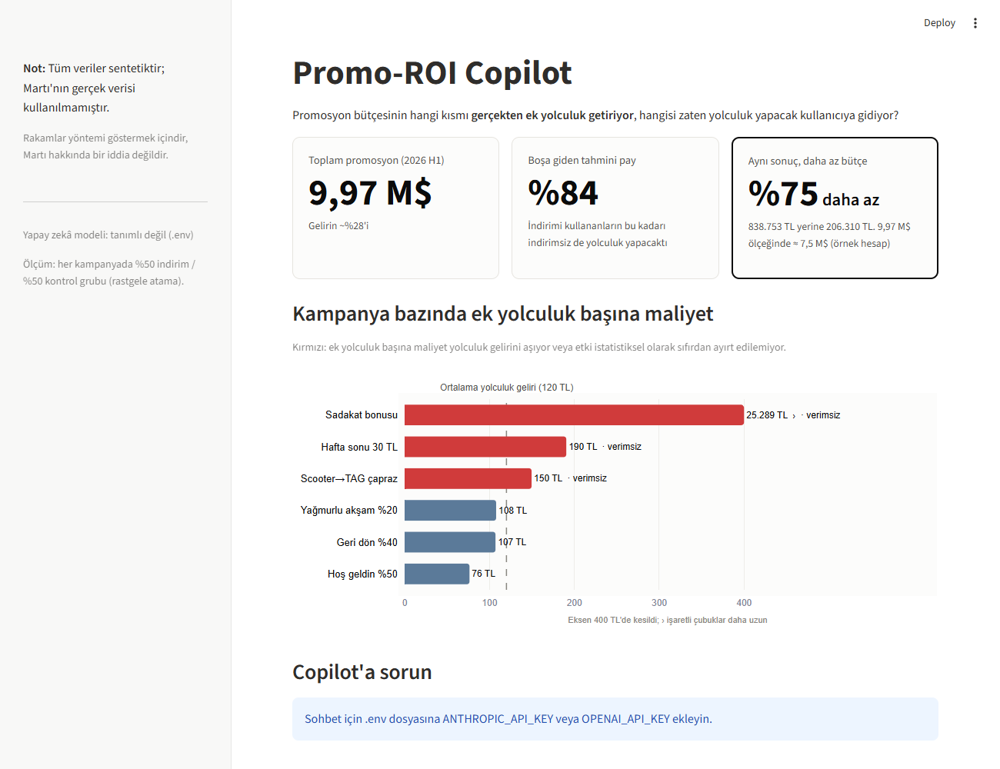
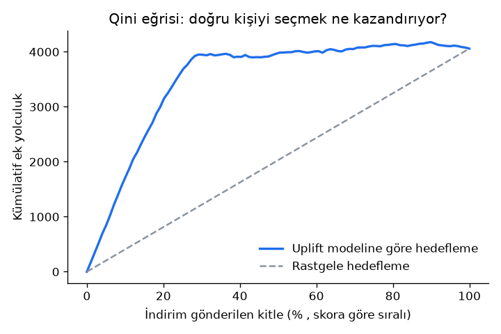
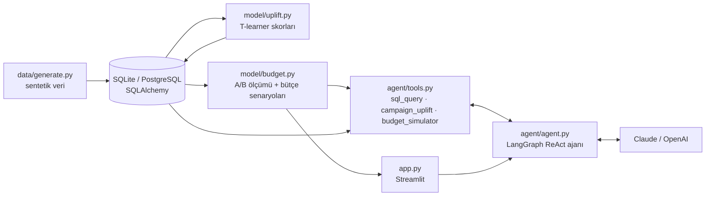

# Martı Promo-ROI Copilot

> Tüm veriler **sentetiktir**. Martı'nın gerçek verisi kullanılmamıştır; buradaki rakamlar
> yöntemi göstermek içindir, Martı hakkında bir iddia değildir.

## Problem

Martı 2026'nın ilk yarısında promosyona **9,97 M$** harcadı; bu, gelirin yaklaşık **%28'i**.
İndirimlerin bir kısmı yeni yolculuk yaratırken, bir kısmı zaten yolculuk yapacak kullanıcıya gidiyor.
Soru basit: **Hangi indirim gerçekten işe yaradı, hangisi boşa gitti?**



## Çalıştırma

```bash
python -m venv .venv && .venv\Scripts\activate      # macOS/Linux: source .venv/bin/activate
pip install -r requirements.txt
copy .env.example .env                               # sohbet için bir API anahtarı girin (macOS/Linux: cp)

python data/generate.py && streamlit run app.py
```

`data/generate.py` veriyi üretir, uplift modelini eğitir ve skorları veritabanına yazar (~25 sn).
Testler: `pytest`

## Uplift nedir? (Ali ve Ayşe)

- **Ali** her gün Martı ile işe gidiyor. Ona %20 indirim verirseniz yine yolculuk yapar,
  ama bu sefer indirimli. Satış raporunda "indirimli yolculuk" görünür, ama **ek yolculuk sıfırdır**;
  indirim doğrudan kâr kaybıdır.
- **Ayşe** uygulamayı yeni indirmiş, kararsız. İndirim gelince ilk yolculuğunu yapıyor.
  Bu yolculuk **indirim sayesinde** oldu.

Klasik raporlar ikisini de "kampanya başarısı" sayar. **Uplift**, yalnızca Ayşe'yi sayar:

```
uplift = P(yolculuk | indirim var) − P(yolculuk | indirim yok)
```

Bunu ölçebilmek için her kampanyada hedef kitlenin **rastgele yarısına indirim verildi, diğer yarısı
kontrol (holdout) grubu olarak bekletildi**. Rastgele atama sayesinde iki grup arasındaki tek fark
indirimdir; yolculuk oranlarındaki fark doğrudan indirimin etkisidir. Holdout olmadan "indirim alanlar
daha çok yolculuk yaptı" demek, Ali'yi de başarı saymak olur.

Model (T-learner) iki ayrı tahminci eğitir: biri indirim alanlar, biri almayanlar için. Her kullanıcı
için iki tahminin farkı o kullanıcının uplift skorudur. Böylece kampanya düzeyinden **kişi düzeyine**
inilir: indirimi kime göndermeli?

## Sonuçlar (sentetik veri, seed = 42)

| | |
|---|---|
| Boşa giden tahmini pay | **%84**: indirimi kullananların, indirimsiz de yolculuk yapacak olan kısmı (harcama ağırlıklı) |
| En verimli kampanya | Hoş geldin %50: ek yolculuk başına **76 TL** |
| En verimsiz kampanya | Sadakat bonusu: 331 bin TL harcama, ek yolculuk neredeyse yok |
| **Aynı ek yolculuk, daha az bütçe** | Rastgele dağıtımın 839 bin TL ile aldığı sonuç, uplift'e göre hedeflemeyle **206 bin TL** (**%75 daha az**) |
| Model doğruluğu | Tahmini uplift ile gizli gerçek uplift korelasyonu **0,91** |

Doğrulama grafiği (Qini eğrisi): skoru en yüksek ~%28'lik kitle, ek yolculukların neredeyse tamamını getiriyor.



## Mimari



| Dosya | Görevi |
|---|---|
| `data/generate.py` | 50.000 kullanıcı, 6 kampanya, %50 holdout. Gizli kullanıcı tipleri ve gerçek uplift ayrı `hidden_truth` tablosunda |
| `model/uplift.py` | T-learner (GradientBoosting), 2 katlı çapraz tahmin, korelasyon + Qini doğrulaması |
| `model/budget.py` | Kampanya bazında A/B ölçümü (%95 güven aralığıyla) ve "rastgele vs. akıllı" bütçe karşılaştırması |
| `agent/tools.py` | Ajanın araçları. SQL aracı yalnızca tek bir SELECT çalıştırır, en fazla 200 satır döner, gizli tabloya erişemez |
| `agent/agent.py` | LangGraph ile ReAct döngüsü. "Nasıl hesapladım" bölümü LLM'e bırakılmaz, gerçekten çağrılan araçlardan üretilir |
| `app.py` | Tek sayfa: rakam kartları, kampanya grafiği, sohbet |

**Gizli tipler (yalnızca doğrulama için):** zaten gelecek (indirim etkisi ~0), ikna edilebilir (yüksek etki),
kayıp (~0), rahatsız olan (hafif negatif). Model bu tipleri hiç görmez; sadece kullanıcı özelliklerinden öğrenir.

**Bütçe senaryosu nasıl değerlendiriliyor?** Kime indirim gideceğine yalnızca model skorları karar verir
(tahmini uplift ÷ tahmini maliyet, en verimliden başlayarak). Seçilen kullanıcıların sonucu ise sentetik
dünyanın gizli gerçeğiyle ölçülür. Ek yolculuk başına tahmini maliyeti yolculuk gelirini (120 TL varsayımı)
aşan kullanıcıya indirim gönderilmez.

## Gerçek hayatta Martı verisiyle nasıl çalışır?

- **Holdout testi:** Her kampanyada küçük bir kontrol grubu (örneğin %10) indirimsiz bırakılır. Bu,
  uplift ölçümünün tek dürüst yoludur; model bu veriyle eğitilir ve her çeyrek yeni bir holdout ile doğrulanır.
- **Veri akışı:** Kampanya atamaları ve yolculuk olayları zaten Kafka'da akıyorsa, günlük bir Airflow
  işi bunları kullanıcı-kampanya tablosuna toplar, modeli yeniden eğitir ve skorları yazar. Kampanya
  aracı indirimi göndermeden önce skora bakar.
- **PostgreSQL'e geçiş:** Kod SQLAlchemy kullanıyor; `.env` içinde `DATABASE_URL` tanımlamak yeterli.
  Ajan için salt-okunur bir veritabanı kullanıcısı açılmalı (SQL aracındaki kontrollerin üzerine ikinci kilit).

## Güvenlik

- API anahtarları yalnızca yerel `.env` dosyasında durur; `.gitignore` bu dosyayı dışarıda tutar. Repoda sadece boş şablon olan `.env.example` vardır.
- Veritabanı repoda yoktur, `python data/generate.py` ile yeniden üretilir. Gerçek bir müşteri verisi içermez.
- Ajanın SQL aracı yalnızca tek bir SELECT çalıştırır; yazma komutları ve doğrulama tablosu (`hidden_truth`) reddedilir.
- Gerçek kullanımda ajan için salt-okunur bir veritabanı kullanıcısı açın.

## Sınırlamalar

- Veri sentetiktir; kullanıcı tipleri, oranlar ve maliyetler varsayımdır. Rakamlar Martı hakkında iddia değildir.
- 9,97 M$ ve %28 dışındaki tüm rakamlar demodaki örneklemden gelir. "9,97 M$ ölçeğinde ≈ X M$" ifadesi
  yalnızca örnek bir hesaptır.
- Kampanyalar birbirinden bağımsız varsayılmıştır (aynı kullanıcıya birden fazla kampanya gidebilir).
- "Ek yolculuk", indirim sayesinde 14 gün içinde yolculuk yapmaya başlayan kullanıcı olarak sayılır.
  Uzun vadeli etki (alışkanlık, müşteri yaşam boyu değeri) modellenmemiştir.
- Bütçe senaryosunun sonucu sentetik gerçekle ölçülür. Gerçek hayatta bunun yerini yeni bir holdout testi alır.
- Şehir bazında örneklem küçüldükçe güven aralıkları genişler. Ajan bu durumda "kanıt yok" der, "etki sıfır" demez.
